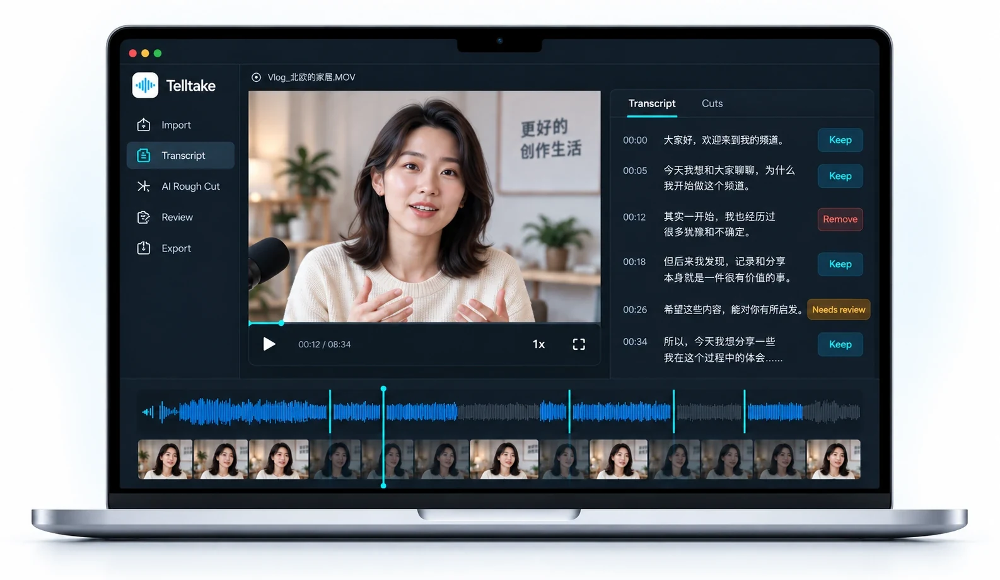
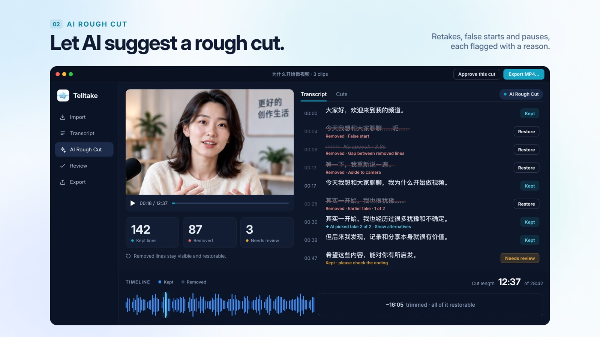
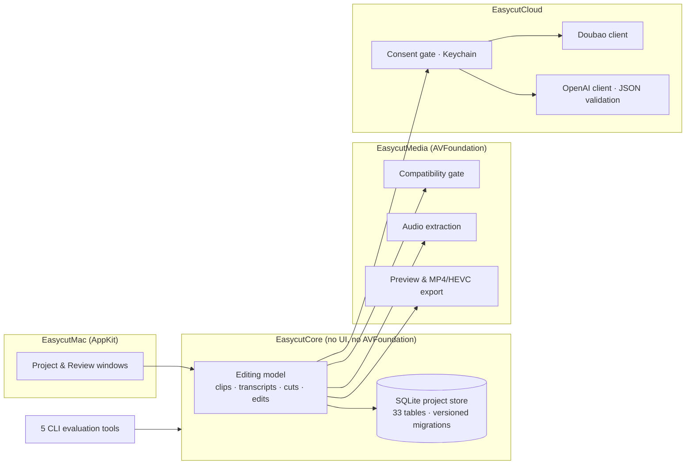

#  Telltake

**Turn a talking-head recording into a rough cut by editing its transcript.**
Native macOS app · Swift 6 · [telltake.com](https://telltake.com) · v1.0.1 released 23 Sep 2026

Illustrative preview from telltake.com.

Telltake is for solo, Mandarin-first creators who record a 20–30 minute talking-head session as a pile of clips and then spend an hour finding the failed starts, retakes and dead air. Import the clips, transcribe them, let the model propose a **rough cut**, then review every proposed removal *in the transcript* — restore, trim, fix pauses — and export an MP4 rendered from the original media. Nothing is ever deleted; every AI decision is visible and reversible.

> **About this repository.** The application source is private. This repo publishes what I think is the more interesting half of the project: the architecture, the 110 architecture decision records that governed the build, the data model, the evaluation protocol and the measurements. Source access for review or interview purposes: rongzhi.dennis@gmail.com.

## What it does

1. **Import & confirm** — order clips by capture time, leave clips out non-destructively, and run a media compatibility gate (dimensions, frame timing, audio, orientation, colour format) before anything is processed.
2. **Transcribe** — extract audio locally and send one clip at a time to Doubao Turbo ASR (ByteDance/Volcengine), with durable per-clip checkpoints: stop keeps finished work; retry reuses it.
3. **AI Rough Cut** — send the transcript *text* (never audio) to OpenAI GPT-5.6 with a frozen prompt and strict JSON output. The model returns the contiguous passages to keep. **Every quoted passage is validated against the saved transcript**; anything that can't be placed exactly is kept and flagged *Needs review* with a reason.
4. **Review** — keep/remove lines and gaps, take groups, line ends snapped to real frames, manual pause shortening, text corrections, persistent undo / session redo, playback that follows the cut.
5. **Preview, approve, export** — watch the full cut, approve the exact plan, and render an MP4 that preserves the source's resolution, frame rate, audio and colour (HDR sources → 10-bit HEVC with the source's tags).

The review model: every removal is visible, explained and restorable. Illustrative preview with sample footage.

## Architecture

One Swift 6 package, 12 modules, ~19k lines of source and ~11k lines of tests (431 tests across 5 targets, with real media fixtures).

| Module | Responsibility |
|---|---|
| `EasycutCore` | Portable editing model and the SQLite project store: clips and sequence, immutable transcript versions, cut lineage (AI cut → Creator Cut), append-only edit operations, export plans, backup/recovery, relinking moved media by content fingerprint. Zero UI or media imports, so it is fully unit-testable. |
| `EasycutMedia` | AVFoundation adapters: inspection, timestamp-preserving PCM extraction, frame-snapped boundaries, preview composition, MP4 rendering. |
| `EasycutCloud` | Doubao and OpenAI clients behind one guarded HTTP boundary, consent and Keychain credential handling, usage metering. |
| `EasycutMac` | The AppKit app and string catalog. |
| CLI tools | Reference reconstruction, text-cleanup reports, retake experiments, transcription comparison and benchmarking — evaluation only, never shipped in the app. |

Concurrency: Swift structured concurrency with 8 actors and `@MainActor` UI isolation; transcription runs two clips in flight with durable checkpoints ([ADR-110](docs/decisions/ADR-110-transcription-progress-and-concurrency.md)). Persistence: SQLite is the canonical project state ([ADR-050](docs/decisions/ADR-050-sqlite-canonical-project-state.md)) inside a portable `.easycut` package ([ADR-049](docs/decisions/ADR-049-project-package-format.md)); see [`docs/schema/`](docs/schema/) for the catalog and migrations.

## Design principles

These are the decisions I'd defend in a review; each links to the record where it was made.

- **Never trust the model blindly.** Model output is a *proposal*; the app re-derives every span from the transcript it already holds and degrades to "keep + flag" on any mismatch. [ADR-023](docs/decisions/ADR-023-conservative-degradation-on-uncertainty.md), [ADR-107](docs/decisions/ADR-107-continuous-text-rough-cut.md)
- **Reversible automation.** The AI cut is immutable; the creator edits a separate Creator Cut with append-only operations and persistent undo. Source media is never modified. [ADR-003](docs/decisions/ADR-003-reversible-automation-boundary.md), [ADR-064](docs/decisions/ADR-064-append-only-edit-operations.md), [ADR-065](docs/decisions/ADR-065-persistent-undo-session-redo.md)
- **Resumable by construction.** Long cloud jobs checkpoint per clip; a crash or Stop never loses finished work. [ADR-077](docs/decisions/ADR-077-durable-transcription.md), [ADR-110](docs/decisions/ADR-110-transcription-progress-and-concurrency.md)
- **Data-minimising cloud use.** Only extracted audio goes to the ASR provider and only text goes to the LLM, after explicit consent; keys live in the Keychain; [`docs/privacy.md`](docs/privacy.md) states exactly what leaves the Mac. [ADR-006](docs/decisions/ADR-006-data-minimizing-cloud-processing.md), [ADR-093](docs/decisions/ADR-093-user-level-cloud-processing-consent.md)
- **Measured, not claimed.** A written evaluation protocol with precision and critical-error gates, minimum-evidence thresholds, and a consent-aware dataset registry that separates tuning from held-out creators. [ADR-073](docs/decisions/ADR-073-review-contract-clarifications.md), [ADR-076](docs/decisions/ADR-076-dataset-registry.md)
- **Cost is a feature.** Model tiering and per-request usage accounting after a long-context bill made the trade-off concrete. [ADR-100](docs/decisions/ADR-100-cost-sensitive-text-analysis-model.md), [ADR-102](docs/decisions/ADR-102-compact-analysis-and-usage-accounting.md)

## Evaluation

The [evaluation protocol](docs/evaluation-protocol.md) defines what "works" means: ≥98% precision on automatic exclusions, zero critical false exclusions, minimum evidence of 500 scored exclusions / 20 sessions / 10 held-out creators, and *active creator review time* — not wall-clock — as the primary KPI ([ADR-032](docs/decisions/ADR-032-active-review-time-as-primary-kpi.md)).

First evidence run ([Test23](docs/evidence/test23-rough-cut-2026-09.md), one creator, development data — not a held-out claim): 39 clips, 66:24 of source → AI Rough Cut 34:38 → Creator Cut 29:08. The creator reversed **0 of 353** AI speech removals and changed 1 of 607 speech lines; the remaining edits were pause removals.

Speech-provider selection was done with reproducible operator tooling (hashed inputs, raw responses, provenance manifests, HTML reports) across Doubao, Whisper, Microsoft LLM Speech, Deepgram and Soniox — see [`docs/experiments/`](docs/experiments/).

## How it was built

Solo, 18 Aug → 23 Sep 2026. Working method: write the decision first (ADR), then the tests, then let AI coding agents (Claude Code, Codex) implement against both; 111 ADRs and the 431-test suite are what kept five weeks of generated code coherent. The [ADR index](docs/decisions/README.md) explains which decisions govern and how later ones amend earlier ones.

## Documentation map

| | |
|---|---|
| [Product brief](docs/product-brief.md) | Who it's for, the core workflow, the safety and quality bar |
| [Code architecture](docs/code-architecture.md) | Module boundaries, ports and adapters, growth plan |
| [Decision records](docs/decisions/README.md) | 110 ADRs with an index of what currently governs |
| [Workflows](docs/workflows/) | Per-stage specs: transcription, cloud processing, creator cut, preview, export, recovery… |
| [Schema](docs/schema/) | SQLite catalog and ordered migrations |
| [Evaluation protocol](docs/evaluation-protocol.md) · [Dataset registry](docs/dataset-registry.md) · [Evidence](docs/evidence/) | How quality is measured |
| [Experiments](docs/experiments/) | Provider comparisons and text-cleanup trials |
| [Privacy](docs/privacy.md) · [Glossary](docs/glossary.md) · [Changelog](CHANGELOG.md) | |

## Licence

Documentation in this repository is © 2026 Rongzhi Chen and released under [CC BY-NC-ND 4.0](LICENSE): read, link and quote with attribution; no commercial use or derivative works. The Telltake application is distributed under its own terms at telltake.com.
